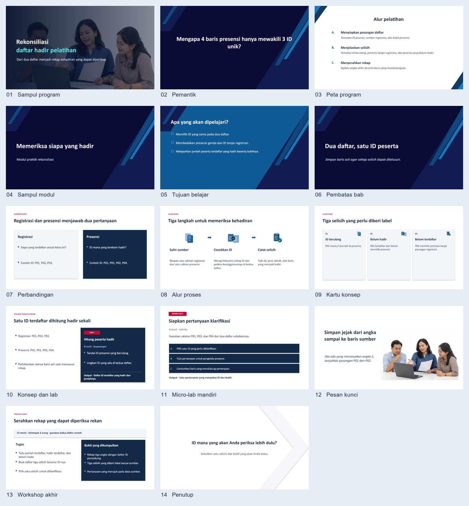

# PPT Instruktur

Skill untuk membuat slide yang dapat langsung dibawakan di kelas. AI memilih pola sesuai materi: menjelaskan konsep, menunjukkan contoh, mendampingi latihan, atau memeriksa hasil kerja peserta. Paket ini berisi template PowerPoint editable, contoh brief, generator opsional, dan panduan gambar serta speaker notes.

## Pasang dari GitHub

1. Ekstrak paket dan masukkan folder `.github` beserta `README.md` ke **root** repositori GitHub pilihan Anda. Pastikan halaman repo menampilkan `.github/skills/ppt-instruktur/SKILL.md`. Folder `.github` mungkin tersembunyi di pengelola file. GitHub Desktop atau Git dapat menyertakannya.
2. Di **Agentic Skill Installer**, tempel URL repositori. Untuk menunjuk direktori skills secara langsung, gunakan `https://github.com/PEMILIK/REPO/tree/main/.github/skills`. Sesuaikan pemilik, nama repo, dan cabang. Tekan Enter, lalu pilih **ppt-instruktur** jika tersedia dalam daftar hasil.
3. Di chat AI pada alat yang memuat skill tersebut, sebut **PPT Instruktur** bersama topik, peserta, durasi, dan sumber. Di klien yang mendukung pemanggilan dengan nama skill, gunakan `$ppt-instruktur`.

VS Code mendukung skill proyek pada direktori `.github/skills`. Untuk alat lain yang menerima format Agent Skills, salin seluruh direktori `ppt-instruktur` ke lokasi skill yang ditetapkan alat tersebut. Pertahankan subfolder agar template, referensi, dan skrip dapat ditemukan. [Dokumentasi VS Code](https://code.visualstudio.com/docs/agent-customization/agent-skills) · [Spesifikasi Agent Skills](https://agentskills.io/specification)

## Contoh permintaan

> Gunakan PPT Instruktur untuk membuat PPTX pelatihan audit bukti lapangan bagi auditor pemula. Durasi 90 menit. Gunakan studi kasus dan foto terlampir. Sertakan latihan berpasangan, bukti yang harus dikumpulkan, pembahasan di speaker notes, dan pembagian waktu yang totalnya 90 menit.

## Isi paket

- [SKILL.md](.github/skills/ppt-instruktur/SKILL.md) menjelaskan alur dari materi sumber sampai pemeriksaan file final.
- [Template-Instruktur.pptx](.github/skills/ppt-instruktur/assets/Template-Instruktur.pptx) memuat 14 komposisi yang dapat diedit. Contoh bertema rekonsiliasi daftar hadir.
- [Pola pengajaran dan visual](.github/skills/ppt-instruktur/references/pola.md) merangkum pola dari deck pembuka, Day 1, dan Day 2.
- [Panduan generator](.github/skills/ppt-instruktur/references/pembuatan.md) menjelaskan cara menghasilkan PPTX di komputer yang memiliki Python dan dependensi. Skill juga dapat dipakai dengan editor presentasi lain yang bisa membaca resource di folder skill.

Foto kelas adalah ilustrasi AI yang dibuat untuk paket ini. Ikon dan komposisi portabel dibuat ulang. Untuk materi beridentitas lembaga, sertakan logo dan template resmi pada permintaan.
